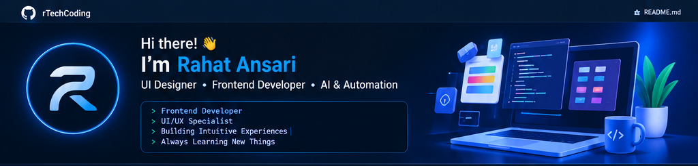

# Hi there! 👋 I'm Rahat Ansari

### UI Designer · Frontend Developer · AI & Automation

---

<table>
<tr>
<td width="58%" valign="top">

## 👤 About Me

I'm a UI Designer and Frontend Developer focused on creating clean, responsive, user-friendly, and conversion-focused digital experiences.

I enjoy turning ideas, designs, and business requirements into polished web interfaces that are fast, accessible, and easy to maintain.

Currently, I contribute to digital experiences at **Axiever Inc.**, with a focus on engaging user experiences and business-focused frontend solutions.

</td>
<td width="42%" valign="top">

## ⚡ What I Do

- UI/UX Design
- Frontend Development
- Responsive Web Design
- Website Performance
- WordPress Development
- ERP & Business Application UI
- Dashboards & Data Visualization
- AI & Automation Interfaces
- Interactive Forms & Workflows
- Landing Pages & Marketing Websites

</td>
</tr>
</table>

## 🧰 Tech Stack

**Frontend Development**

**UI / UX & Design**

**CMS, Platforms & Tools**

---

<table>
<tr>
<td width="40%" valign="top">

## ⭐ Core Skills

| Area | Focus |
|---|---|
| UI/UX Design | User-centered interfaces |
| Responsive Design | Mobile-first layouts |
| Frontend | HTML, CSS, JavaScript |
| UI Components | Forms, modals, sliders |
| ERP UI | Dashboards & workflows |
| WordPress | Custom frontend & forms |
| Performance | Speed & optimization |
| Data Visualization | Charts & reports |
| AI & Automation | Intelligent workflows |

</td>
<td width="60%" valign="top">

## 🏢 Professional Experience

### Axiever ERP

Contributing to modern digital experiences for ERP and business applications, including marketing pages, UI components, forms, dashboards, calculators, and workflow-driven interfaces.

**ERP Areas**

- Finance & Accounting
- Inventory & Supply
- Customer & CRM
- Order Management
- HR & Payroll
- Suppliers & Vendors
- Reports & Dashboards
- Approvals, Alerts & Scheduling
- ROI & Business Calculators

</td>
</tr>
</table>

## 🚀 Featured Work

<table>
<tr>
<td width="33%" valign="top">

### 📊 Manual Work Cost Calculator

A responsive business calculator designed to help users understand the cost of repetitive manual processes.

- Dynamic calculations
- Interactive UI
- Responsive design
- Data visualization
- Report generation

**Tools:** HTML · CSS · JavaScript · Chart.js

</td>
<td width="33%" valign="top">

### 💰 ROI Calculator & Reporting

An interactive ROI experience focused on business efficiency and automation calculations.

- Dynamic calculations
- Interactive charts
- Form validation
- Email report workflow
- WordPress AJAX integration

**Tools:** HTML · CSS · JavaScript · Chart.js · WordPress

</td>
<td width="33%" valign="top">

### 📅 Demo Scheduler

A multi-step scheduling experience inspired by modern booking platforms.

- Calendar and date selection
- Time-slot and timezone selection
- Guest information
- Validation and confirmation
- Email notifications

**Tools:** HTML · CSS · JavaScript · PHP · WordPress

</td>
</tr>
</table>

## ✨ Interactive Web Experiences

## 📈 GitHub Analytics

 

 

> GitHub statistics are loaded from external services. Their availability and displayed information may vary.

## 🎯 Currently Exploring

<table>
<tr>
<td width="50%" valign="top">

- AI-powered web experiences
- Business process automation
- Advanced UI/UX patterns
- Responsive design systems

</td>
<td width="50%" valign="top">

- Reusable UI components
- Interactive dashboards
- ERP application experiences
- Frontend performance optimization

</td>
</tr>
</table>

## 💡 Development Philosophy

### “Design first. Build smart. Keep it simple.”

I believe great frontend development is not only about writing code. It's about understanding the user, simplifying complex workflows, creating clear visual hierarchy, and building interfaces that feel natural to use.

`Understand` → `Design` → `Develop` → `Test` → `Optimize` → `Improve`

## 🌐 Let's Connect

---

### 🚀 Building modern interfaces. Solving real problems. Learning every day.

**“Good design gets attention. Great UX keeps it.”**

⭐ If you find my work useful, consider starring a repository.

